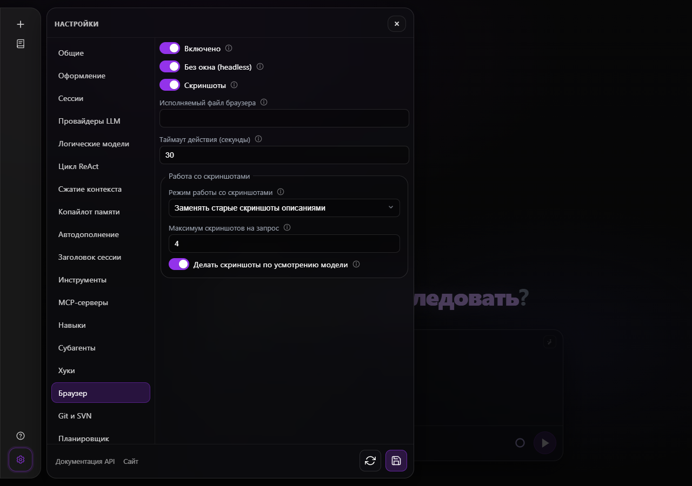

# Interactive browser tool

FoxxyCode ships an optional interactive browser tool set that lets the agent drive a
real Chrome/Chromium instance: open pages, click, fill forms, hover, scroll, run
JavaScript, and — crucially — **see screenshots of the page**. Unlike `webfetch`
(which returns static HTML), the browser tool gives the model visual feedback after
every action, so it can verify web UIs, log into apps, and do visual end‑to‑end
checks.

It is built on [chromedp](https://github.com/chromedp/chromedp) (pure Go, over the
Chrome DevTools Protocol — no Node.js required) and is **disabled by default** via the
`browser.enable` config flag.

## Requirements

- A Chrome or Chromium binary installed on the machine. chromedp auto‑detects a
  common install; override the path with `browser.executable_path` if needed.
- A binary that includes the `browser` build tag. Every shipped binary has it: the
  released archives, the Docker image, `make build TAGS="$(FULL_TAGS)"` (what
  `make install` falls back to), `make desktop`, and the binaries the IntelliJ and
  VS Code plugins bundle inside themselves (each plugin builds its own — see
  `editors/intellij/build.gradle.kts` and `editors/vscode/scripts/prepare-binary.mjs`,
  kept in sync by `TestBundledBinaryTagsMatchShippedTagSet`). A trimmed build without
  the tag registers no browser tools at all, whatever `browser.enable` says.

## Enable it

The settings form tells you which side of that line your binary is on: the **Browser
tool** section is always listed, but in a build without the tag it renders read-only
with a notice naming the tag to rebuild with, instead of a switch that would save
`browser.enable: true` and change nothing. That is driven by two schema annotations
on `GET /foxxycode/config/schema` — `x-foxxycode-requires-build-tag` (always present,
names the tag) and `x-foxxycode-build-tag-missing` (added by the responding process
when it lacks that tag). See [http-api.md](../reference/http-api.md).

If you build your own trimmed binary, add the tag alongside your other ones:

```bash
make build TAGS="http ui browser"
# or
go build -tags=http,ui,browser ./cmd/foxxycode
```

Then turn it on in `config.yaml` — this step is required in every build:

```yaml
browser:
  enable: true          # off by default
  headless: true         # false to watch the automated session in a real window
  screenshots: true      # false = text-only, use read_page / page_log / evaluate
  screenshot_settings:
    mode: keep           # keep, latest, replace_old, or separate_session
    max_screenshots: 0   # 0 leaves the local request limit off
    model_decides: false # true captures only when the model asks
  executable_path: ""    # "" = auto-detect; or a path to a Chrome/Chromium binary
  timeout_seconds: 30     # per-action timeout
```

See [config-reference.md](../reference/config.md#browser) for the full field list.

## Tools

Mutating tools require permission — in an editor plugin that arrives as the usual
ACP permission card; the read-only ones (`screenshot`, `read_page`, `page_log`,
`find`, `inspect`, `network`, `wait_for`, `close`) do not. All of them act on one
browser session per agent session (cookies/storage persist under
`<sessionDir>/browser-profile/`). A screenshot is captured after each mutating
action and shown to the model.

| Tool | Arguments | Purpose |
|---|---|---|
| `foxxycode_browser_navigate` | `url` | Open an `http(s)` URL (localhost allowed). |
| `foxxycode_browser_navigate_back` | `direction?` | Go back (or forward) one entry in the tab's history. |
| `foxxycode_browser_click` | `selector` or `x`,`y` | Click the first element matching a CSS selector, or a viewport point (canvases, maps). |
| `foxxycode_browser_fill` | `selector`, `text` | Set the value of an input/textarea. |
| `foxxycode_browser_fill_form` | `fields[]` | Fill several fields (inputs, textareas, selects, checkboxes) in one call, one screenshot. |
| `foxxycode_browser_press_key` | `key`, `selector?` | Send real key events: Enter, Escape, Tab, arrows, `Control+a`, single characters. |
| `foxxycode_browser_select_option` | `selector`, `value?`/`label?` | List a `<select>`'s options, or pick one by value/label with input+change events. |
| `foxxycode_browser_hover` | `selector` | Move the mouse over an element (triggers `:hover`). |
| `foxxycode_browser_scroll` | `selector` or `x`,`y` | Scroll an element into view, or by a pixel offset. |
| `foxxycode_browser_drag` | `from_selector`/`from_x,from_y`, `to_selector`/`to_x,to_y` | Mouse-event drag (sortable lists, sliders; native HTML5 dnd may not react). |
| `foxxycode_browser_upload_file` | `selector`, `path`/`paths[]` | Attach local files to an `<input type=file>`. |
| `foxxycode_browser_wait_for` | `text?`, `gone_text?`, `selector?`, `seconds?` | Wait for a page state instead of polling. No permission needed. |
| `foxxycode_browser_handle_dialog` | `accept`, `prompt_text?` | Arm the answer for the next `alert`/`confirm`/`prompt`/`beforeunload`. Unarmed dialogs are auto-dismissed and logged, so nothing hangs. |
| `foxxycode_browser_tabs` | `action`, `tab?`, `url?` | List, open, select and close tabs (including pages opened via `target=_blank`). |
| `foxxycode_browser_resize` | `width`, `height` | Emulate a viewport size (390×844, 1280×800, …); `0,0` resets. |
| `foxxycode_browser_screenshot` | — | Capture the current page. |
| `foxxycode_browser_read_page` | `interactive_only?` | Outline the page as text: role, name, value and a CSS selector per element. No screenshot. |
| `foxxycode_browser_find` | `query` | Search the page for elements whose role/text/value/selector contains the query; reports outline lines. No screenshot. |
| `foxxycode_browser_page_log` | — | Console output, uncaught exceptions and failed / 4xx / 5xx responses since the last read. No screenshot. |
| `foxxycode_browser_inspect` | `what` | Report `storage` (localStorage / sessionStorage / cookies), `timing` (load phases, slowest requests) or `memory` (JS heap, DOM size). No screenshot. |
| `foxxycode_browser_network` | `what`, `filter?`, `id?` | Journal of all observed requests (method, status, size, id), and response bodies by id. No screenshot. |
| `foxxycode_browser_route` | `action`, `url_substring?`, `status?`, `content_type?`, `body?` | Mock responses for matching URLs, remove/list mocks, or emulate offline/online. |
| `foxxycode_browser_storage_set` | `scope`, `action`, `key?`, `value?` | Write localStorage / sessionStorage / cookies: set, delete, clear. |
| `foxxycode_browser_evaluate` | `expression` | Evaluate JavaScript and return its JSON result. |
| `foxxycode_browser_close` | — | Close the browser for this session. |

### Dialogs never hang an action

A `confirm()` or `alert()` blocks the page, which used to leave the triggering
click waiting for its timeout. Now every dialog is answered automatically —
dismissed by default, `beforeunload` accepted so navigation still works — and the
page log records what appeared. To answer differently, call
`foxxycode_browser_handle_dialog` **before** the action that triggers the dialog:
the armed answer applies to the next dialog only.

### Network mocks and the request journal

`foxxycode_browser_network` sees every request the pages made — not just the
failures the page log reports — and can return response bodies, which is how a
"successful but wrong" API answer is diagnosed. `foxxycode_browser_route` mocks
responses by URL substring across all tabs (`action=mock` / `unroute` / `list`)
and toggles offline emulation (`action=offline` / `online`); mocks apply to
future requests, so set them up before navigating or triggering the fetch.

## Working with screenshots

Open **Settings → Browser tool → Working with screenshots** to choose how the
agent receives screenshots. Captured files remain in the session's assets for
inspection in the transcript.



*Screenshot settings with a four-image budget and capture on request.*

| Mode | What the main model receives |
|---|---|
| Keep screenshots in context (`keep`, default) | The browser screenshots captured so far in the current turn, up to the configured budget. Beyond the budget, the oldest images are omitted from the request. |
| Remove intermediate screenshots (`latest`) | The latest screenshot and model-written descriptions of the earlier screenshots it replaced. |
| Replace old screenshots with descriptions (`replace_old`) | Recent screenshots up to the budget. When another frame would exceed it, the model describes the oldest frame and its description takes the place of the image. |
| Process screenshots in a separate session (`separate_session`) | A text report from a tool-free subagent. The child receives one screenshot and its visual check prompt, then returns a description and the result of the check. This mode needs enabled subagents and an available slot. |

`max_screenshots` applies to each model request. User image attachments reserve
their slots before browser screenshots. For a four-image model, set it to `4`.
If the provider reports an image-count error before returning any output, the
agent retries the model request with fewer browser screenshots. Completed browser
actions and commands remain completed. User attachments are preserved, so a
request whose attachments already exceed the provider's limit still needs fewer
user images.

Replacing a screenshot inside the prompt can reduce prompt cache reuse from
that position onward. Descriptions and separate reviews also add a model call
for each frame they handle. For long runs, enable **Take screenshots at the
model's discretion**. The model can pass `screenshot: true` on actions such as
navigate, click, fill, scroll or wait, or call `foxxycode_browser_screenshot`
explicitly. `screenshot: false` skips an automatic capture for that action.
Use the optional `screenshot_prompt` to specify a check, such as whether the
lower button in a dialog is visible. `browser.screenshots: false` disables all
captures.

## Driving it without screenshots

In the bundled chat, browser calls have localized action headings and a browser
icon. Expanded calls show the target URL or CSS selector, formatted JavaScript
for `evaluate`, and the screenshot or text result below. Long code and results
have More/Less controls and a bounded scrolling viewport. Page logs highlight
warnings and errors; inspect reports use tables. Screenshot previews enlarge on
click. The same argument presentation is used when asking for permission.

For `scroll`, numeric X/Y values are **relative offsets** from the current position,
including negative values. The UI draws their direction and signed pixel values
inside a small screen rectangle; a zero offset has no arrow. When a nonempty
`selector` is supplied, it takes precedence over both offsets.

Two of the tools never capture an image, so a model that cannot see is not stuck
with `webfetch`:

- **`foxxycode_browser_read_page`** renders the page as an indented outline —
  role, visible name, current value, and a CSS selector to pass straight to
  `click` or `fill`. It is the cheap answer to "what is on this page and what is
  the button called", and it beats guessing selectors from source.
- **`foxxycode_browser_page_log`** reports what the page said about itself:
  `console.*` calls, uncaught exceptions (with the real message, not just
  `Uncaught`), and network responses that failed or came back 4xx/5xx. A backend
  that 500s is invisible in a screenshot unless the app happens to render an
  error, so this is often the only tool that explains a blank page.

- **`foxxycode_browser_inspect`** answers the questions a picture cannot. `storage`
  lists localStorage, sessionStorage and cookies with values truncated — the usual
  explanation for "it works for me but not for you"; note that httpOnly cookies are
  invisible to page script and are not listed. `timing` breaks the page load into
  phases and names the slowest requests. `memory` reports the JS heap where Chrome
  exposes it (it is not always available, and the tool says so instead of printing
  zeroes) plus the DOM node count, which is usually the more actionable number.

All three are reachable through `evaluate` as well; they exist so the model does not
have to know which incantation to write, and so the answer comes back in the same
shape every time. They are one tool with a subject rather than three tools because
every definition is sent on every request, and a longer list makes the choice harder
for a small model.

None of them needs permission: they read what already happened and change nothing.

The log is **cleared by whoever reads it first**. Actions append it to their own
result, so after a `navigate` the tool may legitimately report nothing — what it
returns is "since the last read", not "everything ever".

Set `browser.screenshots: false` to stop capturing images altogether. Actions then
report the URL, the page log, and the line `screenshot: disabled`, and hand the
model nothing to look at. On a text-only model that is strictly better: it saves
the ~40 KB of base64 that every action would otherwise add to the request, and the
image was never going to be read.

## Models without vision

The screenshot only helps a model that can read images. Endpoints disagree about how
they say otherwise: `api.neuraldeep.ru` answers HTTP 405 `Model ... does not accept
image input` for a text-only model group, OpenAI rejects the content part by name.
Rather than fail the turn, the LLM layer detects that rejection and immediately
re-issues the same request with the images replaced by a short `[image not shown]`
note, so the run continues on the text results alone. It is logged at warn level.

Two consequences worth knowing:

- A text-only model still drives the browser correctly — it just cannot see the
  page, so prefer `foxxycode_browser_evaluate` to read the DOM there.
- The advertised capability is not always right. NeuralDeep lists `gpt-oss-120b` as
  `vision: false` while the endpoint in fact accepts images, which is why nothing is
  blocked up front: the fallback reacts to the actual answer instead.

## How the model sees screenshots

Tool results are text‑only. When the selected policy sends an image to the main
model, the agent adds a **user-role vision block** after the browser tool round.
Images and their replacement notes live in the current agent turn. Each screenshot
is also saved to the session
`assets/` directory and served to the UI via
`GET /foxxycode/sessions/{id}/assets/{name}` (see [http-api.md](../reference/http-api.md)), where
the transcript renders it inline in a browser‑action card.

## Reopening the browser

Chrome belongs to the live session. Stopping a turn or refreshing the client
keeps its tabs available on the next turn while the backend is still running.
Closing the browser tool or releasing the live session closes Chrome. If Chrome
exits on its own, the next browser action starts it again.

After an abrupt backend restart, a Chrome process left running may still hold
the session profile. FoxxyCode starts a separate Chrome with a temporary
profile and reports that in the action result. The old process and its profile
are left untouched. Existing logins, cookies, and site storage are unavailable
in the temporary browser. Once the old process has closed, close the temporary
browser with `foxxycode_browser_close` and run the next browser action to reopen
the original profile.

## Security notes

- The navigate target must be `http`/`https` and must not embed userinfo
  credentials. Unlike the `webfetch` SSRF guard, localhost/private hosts **are**
  allowed, because driving a local dev server is the primary use case — the tool is
  already opt‑in behind the build tag and `browser.enable`.
- Keep `browser.enable: false` (or build without the `browser` build tag) in
  environments where you do not want the agent launching a browser. The flag
  defaults to off, so a full build is inert until it is switched on.
