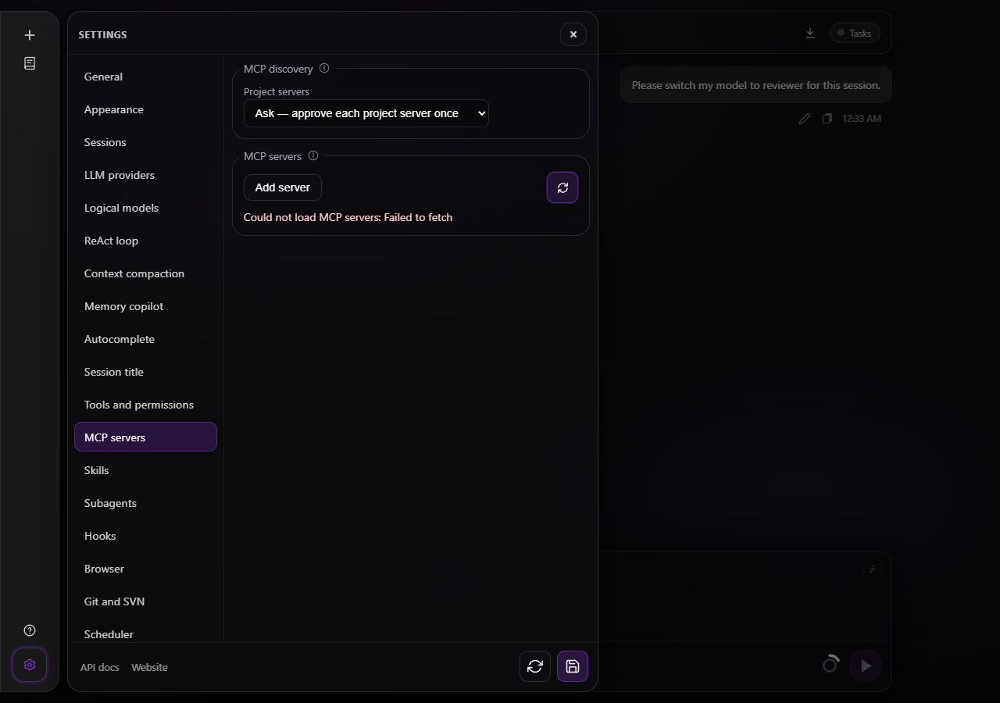
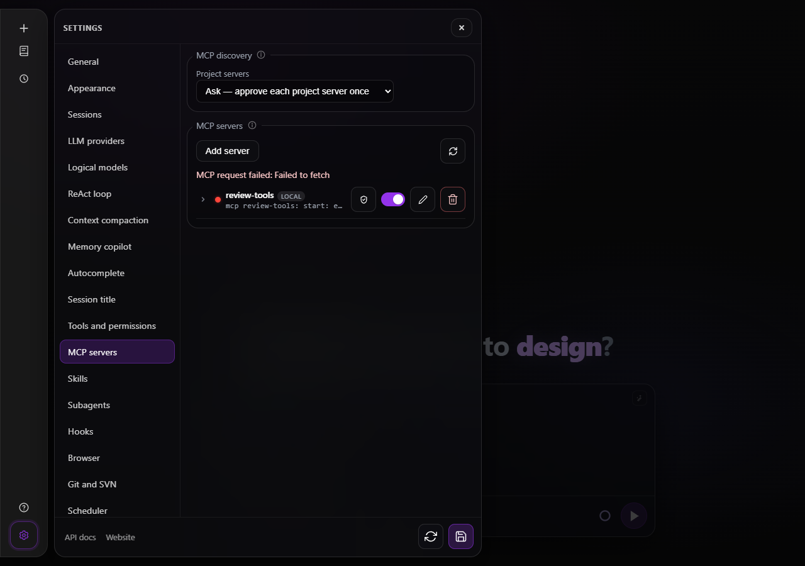
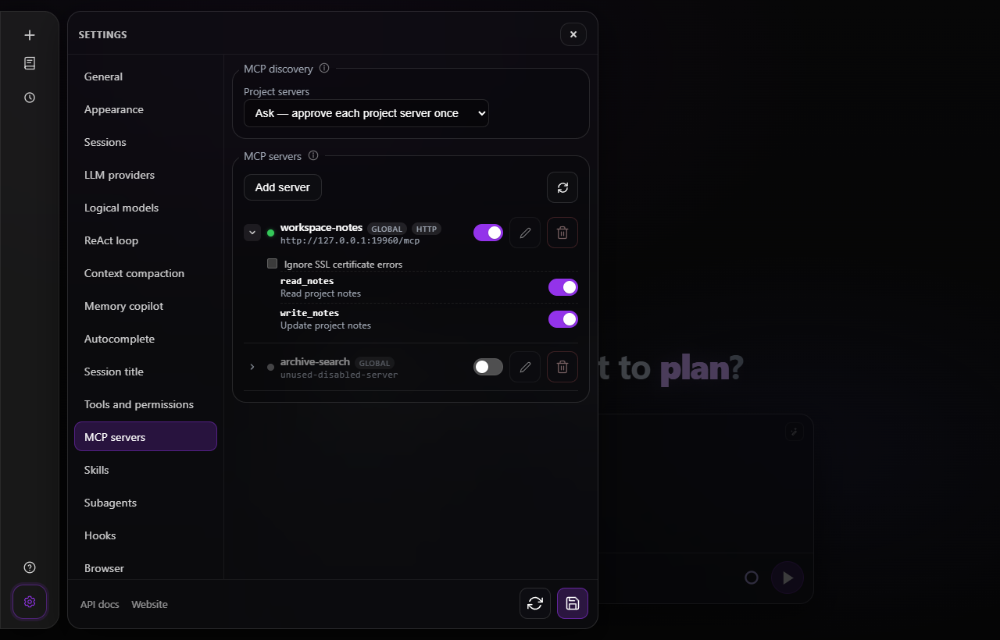

# MCP Server Integration

## Overview

The agent supports connecting to external MCP (Model Context Protocol) servers, which provide
additional tools and resources. MCP servers can be configured at these levels:

1. **Global** (scope `global`) - `mcp_servers` in `config.yaml` and the user-global
   `~/.foxxycode/mcp.json` (the analogue of Cursor's `~/.cursor/mcp.json`; in the agent home,
   so elsewhere if `FOXXYCODE_HOME` or `--home` moved it), one running server shared by every
   session of the process ([Shared servers](#shared-servers)); entries in that file
   override same-named `config.yaml` entries
2. **Local** (scope `local`) - `<workspace>/.foxxycode/mcp.json`, merged over the global list for
   sessions in that workspace, one running server per workspace; a local entry with the
   same name overrides the global definition
3. **Per-session** - provided by the ACP client in `session/new` parameters

Tools from all connected MCP servers are merged into the tool list passed to the LLM during
the ReAct loop (in **`agent`**, **`plan`**, and **`debug`** modes). Ask and docs never receive MCP
tools: MCP servers expose no enforceable read-only guarantee, so both closed surfaces leave them out.

## mcp.json (global and local)

Both mcp.json files use the same shape as Cursor's: a single `mcpServers` object keyed by
server name. `env` and `headers` are JSON objects (not the YAML name/value list), and
per-tool switches use `disabledTools`:

```json
{
  "mcpServers": {
    "filesystem": {
      "command": "npx",
      "args": ["-y", "@modelcontextprotocol/server-filesystem", "${CWD}"],
      "env": { "SOME_TOKEN": "value" },
      "disabled": false,
      "disabledTools": ["write_file"]
    }
  }
}
```

A broken `mcp.json` is logged and skipped; the session still starts with the remaining levels.

## Workspace trust for project-local servers

`<workspace>/.foxxycode/mcp.json` travels with the checkout, so the **repository** — not the
operator — picks the command, arguments, and environment of a process FoxxyCode would start
while bootstrapping a session. Nothing on the path to that spawn can make a trust decision:
it happens before the first turn exists, so there is no model request, no permission prompt,
and no `tools.permission_mode` to consult. Opening someone else's repository would otherwise
mean running whatever it declared.

Project-origin declarations therefore pass a trust gate before any spawn or connect.
`config.yaml` and `<home>/mcp.json` are operator-authored and stay ungated.

`mcp.project_trust` in `config.yaml` chooses the policy:

| Value | Behaviour |
|---|---|
| `ask` (default) | A project server stays cold until the operator approves **that exact declaration** for **that workspace**. |
| `allow` | Project servers start automatically. Use only for workspaces you already trust. |
| `deny` | Project servers are never loaded and there is no approval path. |

Override it for one process with `foxxycode acp --mcp-project-trust <value>` or
`foxxycode http --mcp-project-trust <value>`, which is what CI jobs and container entrypoints
use instead of editing the config file. An unknown value fails the launch rather than falling
back to the default.

### Approving

Three surfaces make the same decision, and all of them print the effective declaration first —
transport, the command with its arguments (or the URL), the **names** of the environment
variables and headers it carries, the workspace, and the source file:

- `foxxycode mcp list` — every merged server with its trust state; `foxxycode mcp trust <name>`
  and `foxxycode mcp untrust <name>` decide. `--cwd DIR` picks the workspace.
- `POST /foxxycode/mcp/{name}/trust` and `/untrust` over the HTTP API.
- The shield button in **Settings → MCP servers**, which renders only under `ask` (the other
  two policies leave no per-server decision to make).

Writing an entry through the management API or the UI editor approves it: the operator typed
the command themselves.

Approvals live in `<home>/mcp-trust.json`, keyed by canonical workspace path and bound to a
SHA-256 digest of the command-bearing declaration (transport, command, args, env, url,
headers). Operational switches — `disabled`, `disabledTools` — are deliberately **outside**
the digest, so toggling a tool off does not withdraw an approval, while editing the command
line does. Records are receipts of what was approved and store env and header **names** only:
their values routinely hold secrets, and the decision rests on which variables travel to the
child, not on what is in them.

Listing servers is gated too: probing an unapproved entry would start exactly the command the
approval is about, so `GET /foxxycode/mcp` reports it (`status: needs_approval`) instead.

Subagent definitions found inside the workspace (`.foxxycode/agents`, `.claude/agents`) follow the
same model with a **sibling store**: policy `subagents.project_trust` (`ask` / `allow` / `deny`),
receipts in `~/.foxxycode/subagents-trust.json` keyed by the same canonical workspace path plus the
definition name and a digest of the file, approved with `foxxycode agents trust <name>` or
`POST /foxxycode/subagents/{name}/trust`. The two files are deliberately separate so an MCP approval
never reads as an agent approval or the reverse. A child agent that may use MCP tools does not
borrow the parent's connections: configured servers are re-resolved for the child's cwd
**through this trust gate**, exactly as for a new session, and the parent's ACP client-supplied
servers are redialed ungated, as the original connect was. A child whose tool set cannot contain
MCP names (the built-in `explore`) never dials anything. See `docs/features/subagents.md`.

Hook definition files found inside the workspace (`.foxxycode/hooks.json`, the Claude Code
`.claude/settings.json` and `.claude/settings.local.json`) are the third kind of project-local
content that executes code, and they follow the same model with a third sibling store: policy
`hooks.project_trust` (`ask` / `allow` / `deny`), receipts in `~/.foxxycode/hooks-trust.json` keyed by
the canonical workspace path plus the workspace-relative file path and a digest of the file,
approved with `foxxycode hooks trust <file>` or `POST /foxxycode/hooks/trust`. Under `ask` a held file is
parsed and listed, but none of its hooks runs, and the session records a notice naming the
approval commands. See `docs/features/hooks.md`.

## Enable / disable switches

Every config level supports switching off a whole server or individual tools without
removing their definitions:

- `config.yaml`: `disabled: true` and `disabled_tools: ["tool_a"]` per `mcp_servers` entry
- `~/.foxxycode/mcp.json` and `./.foxxycode/mcp.json`: `"disabled": true` and
  `"disabledTools": ["tool_a"]` per entry when editing the declarations directly
- For project entries, switches made through `/mcp` or Settings are stored in
  `<home>/mcp-overrides.json`, keyed by workspace and server. The checkout's
  `.foxxycode/mcp.json` stays unchanged; these switches override its defaults. Deleting a
  project server through the API or the UI drops its switches once the declaration is gone,
  so a later server of the same name starts from its own declaration, and a delete that
  fails leaves the server switched as it was. While the file cannot be read, every project
  server stays off and the global servers keep their own switches; `/mcp` and Settings
  name the file and the parse error instead of listing the servers until it is repaired.
  This file and `mcp-trust.json` are written under a lock that every process of the home
  takes, so a console and `foxxycode serve` switching or approving at the same moment do not
  write over each other.

Disabled servers are not connected for new sessions. Disabled tools (and all tools of a
disabled server) are hidden from the LLM's tool list and rejected at dispatch. The switches
are re-read on every agent turn, so toggling them (by editing the files or through the
HTTP API / web UI below) also applies to **already running** sessions on their next turn.

A switch made through `/mcp`, Settings or the HTTP API also reaches live sessions at once,
one server at a time: switching a server on connects it in every live session the trust
gate admits it for, switching it off closes it there, and the other servers keep their
processes, so a browser-automation server keeps its pages open. A global server switched
off stops for the whole process, and switched back on it starts again before any session
asks for it. A tool switch reconnects
nothing. A session in the middle of a turn keeps its tools for that turn: a server switched
off or no longer trusted is closed when the turn ends, and one switched on starts when the
session's next turn starts. Saving or deleting a server through the API or Settings reaches
live sessions the same way, and a server whose declaration was edited is started again from
the new one. A configured server that does not answer its handshake within 20 seconds is
left out; an initialization timeout gets one retry on the next prompt
([Server lifecycle](#mcp-server-lifecycle)).

## Management API and UI

The HTTP gateway (build tag `http`) exposes the merged server list with probed tool
inventories and toggle endpoints under **`/foxxycode/mcp*`** (see `docs/reference/http-api.md`), and the
bundled web UI shows them under **Settings -> MCP servers**: status dot per server, a
`global` / `local` scope badge, expandable tool list with per-tool switches, and a
Cursor-style JSON editor for mcp.json entries with a scope picker (global writes
`~/.foxxycode/mcp.json`, local writes `./.foxxycode/mcp.json`). Global switches persist
into their defining file; project switches persist in the operator's home.
`config.yaml` entries are toggle-only here and edited in Settings.

If loading or refreshing the list fails, Settings shows the error and leaves any
previously loaded servers visible. Refresh remains available for another attempt.
A failed switch, trust decision, deletion or save reports the error and releases
its control so the operator can retry without reopening Settings. Overlapping
loads are applied in order: a slower in-flight request never overwrites or
reports over the rows a newer one already brought.



*A malformed list response now ends loading and shows the reason.*



*A rejected change leaves the server switch available for another attempt.*

Type `/mcp` in the web composer to open this Settings section; words after the
command are ignored, as in the console. In the console, `/mcp` opens a list of
global and project servers with connection status and tool counts, and `off`
beside a switched-off server whose status is a trust verdict. Enter opens a
server's controls: toggle the server, expand its tools and toggle one, or
grant or revoke trust for a project declaration. The trust control follows the
rule of the web shield and is offered only under `mcp.project_trust: ask`, since
under `allow` and `deny` there is no per-server decision to take. Before it
records trust the console prints the whole declaration above the choice: the
transport, the command line or the URL, the names of its variables and headers,
the workspace and the file. These controls also work in `--remote` mode through
the server's MCP management routes. Telegram `/mcp` lists servers and offers
enable/disable buttons only for already-trusted entries; in a group it is
answered without a mention, and a failed tap is reported in the menu message.
Approve project declarations in the console, CLI or web UI; a chat cannot grant
workspace trust.

An approval from the console, the web shield or the remote console names the
declaration it was shown by the `fingerprint` the list reported. When the
checkout rewrote the entry between the listing and the approval, the approval is
refused (`409` over HTTP) and nothing is recorded: list the servers again and
review the new declaration.



*The web `/mcp` command opens the server controls, including project trust and per-server switches.*

Above the list sits an **MCP discovery** fieldset carrying `mcp.project_trust`
(`POST /foxxycode/mcp/project-trust`). It lives in this tab rather than in a settings section
of its own because it governs exactly the servers listed below it, and it persists straight
into `config.yaml` instead of joining the settings-document save flow.

## MCP calls in the transcript

The web UI names an MCP call as an action on its server (*calling get_issue on the MCP
server github*) and opens it as a card rather than as JSON: the bar names the server and the
tool, the arguments are fields, and the answer is read by its shape - a JSON object as the
same fields, other JSON indented, Markdown (a heading, a code fence, a list) as a document,
anything else as monospace text. Numbers and JSON are shown as the server wrote them, so
an id past 2^53 (a Discord or Twitter snowflake) is not rounded and a repeated key keeps
both values. A failed call keeps its error as raw text. Only the text
parts of an answer reach the transcript: FoxxyCode passes the `text` content of a
`tools/call` result to the model and drops images and embedded resources. See
[Web UI](../surfaces/web-ui.md) for the card and a screenshot.

## Supported Transports

### stdio (supported)

The MCP server runs as a subprocess. Communication via stdin/stdout (newline-delimited
JSON-RPC 2.0). The subprocess gets a process group of its own, so stopping the server
stops what it started as well ([Shared servers](#shared-servers)).

FoxxyCode runs `command` with `args` exactly as they are written: a program by its path or
by its name on `PATH`, a package runner such as `npx -y <package>` or `uvx <package>`,
a container started with `docker run -i`. What the command needs is the operator's to
provide - Node.js for `npx`, the network for a package that is not in its cache yet -
and FoxxyCode neither rewrites the arguments nor installs anything. A program, an `npx`
package, a streamable HTTP server and an SSE server are each run through a real turn by
`features/mcp_tool_calls.feature` and, in the console, by
`examples/cli/cli_e2e_mcp_servers.py`.

Configuration in `session/new`:
```json
{
  "name": "my-server",
  "command": "/path/to/mcp-server",
  "args": ["--stdio"],
  "env": [
    { "name": "API_KEY", "value": "secret" }
  ]
}
```

Configuration in `config.yaml`:
```yaml
mcp_servers:
  - name: "filesystem"
    command: "npx"
    args: ["-y", "@modelcontextprotocol/server-filesystem", "/home/user/projects"]
    env: []
```

### Streamable HTTP (supported)

`type: http` connects to `url` over the
MCP streamable HTTP transport (2025-03-26 spec): JSON-RPC messages are POSTed to the
endpoint and answered as `application/json` bodies or `text/event-stream` chunks; the
`Mcp-Session-Id` issued on initialize is echoed on subsequent requests. `headers` are sent
with every request (e.g. `Authorization`). URL-only entries (no `command`, no `type`)
default to `http`. When the endpoint rejects the handshake (legacy servers answer POST
with 4xx), the client automatically falls back to the legacy SSE transport at the same
URL, mirroring Cursor and Claude Code behavior. The agent advertises
`mcpCapabilities.http: true` and `mcpCapabilities.sse: true`. In YAML the `type` value
must be `stdio`, `http`, or `sse`; mcp.json and ACP entries additionally accept the
`streamable-http` / `streamable_http` aliases for `http`.

```yaml
mcp_servers:
  - name: "remote-tools"
    type: "http"
    url: "https://mcp.example.com/mcp"
    headers:
      - name: "Authorization"
        value: "Bearer ${MCP_TOKEN}"
```

### SSE (supported, legacy)

`type: sse` forces the 2024-11-05 HTTP+SSE transport: a GET stream at `url` announces the
POST endpoint in its first event and then carries every server-to-client message. Use it
for servers that only implement the older protocol; `type: http` reaches them too via the
automatic fallback.

In `.foxxycode/mcp.json` the same entries look like Cursor's:

```json
{
  "mcpServers": {
    "remote-tools": { "url": "https://mcp.example.com/mcp" },
    "legacy-tools": { "type": "sse", "url": "https://old.example.com/sse" }
  }
}
```

### Self-signed and invalid certificates

Both HTTP transports verify the server's TLS certificate, so an internal server behind a
self-signed or expired certificate fails to connect with an `x509` error. Setting
`insecure_skip_verify` (`insecureSkipVerify` in mcp.json) accepts that server's
certificate without checking it — the checkbox **Ignore SSL certificate errors** in
**Settings → MCP servers** writes the same field:

```yaml
mcp_servers:
  - name: "internal"
    type: "http"
    url: "https://mcp.internal.lan/mcp"
    insecure_skip_verify: true
```

The flag is per server and off by default. It removes the protection against a man in the
middle for that connection — anyone who can intercept the traffic can also present their
own certificate — so turn it on only for a server you trust on a network you trust. It has
no effect on `stdio` servers, which do not open a TLS connection at all.

Because the flag decides *how* the endpoint is contacted, it is part of the approved
declaration: turning it on changes the fingerprint of a project-local entry, which
withdraws its workspace approval and asks again (see the trust gate below).

## Tool Namespacing

To avoid conflicts when multiple MCP servers provide tools with the same name,
tools are namespaced using the server name:

- MCP server `filesystem` providing tool `read_file` -> available as `filesystem__read_file`
- Built-in tool `read_file` -> available as `read_file`

Because `__` separates the server and tool parts, server names must not contain `__`
(the management API rejects such names).

## How tools reach the model

MCP tools are **not** injected into the system prompt text (unlike skills, which render
into a prompt section). They join the built-in tools in the native function-calling
`tools` array of every LLM request, one definition per enabled tool: name
`server__tool`, the server's own `inputSchema`, and the description prefixed with
`[server]` so the model can tell providers apart. When the model emits a tool call whose
name contains `__`, the agent routes it to the owning server over its transport and
returns the MCP result to the model as a regular tool observation - the same loop as
built-in tools, and the same approach Claude Code, Codex, and Cursor use. The end-to-end
happy path (two servers over stdio and streamable HTTP, the model picking one by its
namespaced tool, the result landing in the final answer) is specified in
`features/mcp_tool_calls.feature` for both the OpenAI-compatible HTTP surface and the
ACP session flow.

## Permission Model

MCP tool calls are currently dispatched without the built-in permission prompts that guard
filesystem writes and shell commands; the disable switches above are the mechanism for
restricting what a server may do. Prefer running MCP servers with least-privilege
credentials and disabling tools you do not need.

## Popular MCP Servers

### Filesystem access
```yaml
mcp_servers:
  - name: "filesystem"
    command: "npx"
    args: ["-y", "@modelcontextprotocol/server-filesystem", "${CWD}"]   # session cwd when the server starts
```

### GitHub
```yaml
mcp_servers:
  - name: "github"
    command: "npx"
    args: ["-y", "@modelcontextprotocol/server-github"]
    env:
      - name: "GITHUB_PERSONAL_ACCESS_TOKEN"
        value: "${GITHUB_TOKEN}"
```

### Postgres database
```yaml
mcp_servers:
  - name: "postgres"
    command: "npx"
    args: ["-y", "@modelcontextprotocol/server-postgres", "${DATABASE_URL}"]
```

### Brave Search
```yaml
mcp_servers:
  - name: "brave-search"
    command: "npx"
    args: ["-y", "@modelcontextprotocol/server-brave-search"]
    env:
      - name: "BRAVE_API_KEY"
        value: "${BRAVE_API_KEY}"
```

## Shared servers

A configured server runs once for the sessions that use it, not once per session. Each
session, and each subagent a session spawns, holds a lease on a connection the process
shares:

- A server of the global configuration (`mcp_servers` in `config.yaml`,
  `~/.foxxycode/mcp.json`) is one process for the whole FoxxyCode process. `foxxycode serve`,
  `foxxycode http`, the console and `foxxycode acp` start these servers as they start, before any session asks for
  them, and keep them up until they exit: a session that opens finds them connected, and
  one that closes does not stop them. The set follows the configuration: a server added
  or switched on starts at once, one removed or switched off stops as soon as no session
  holds it, and one that crashed is started again by the next session or turn that needs
  it. A one-shot `foxxycode -p` starts them for its session and stops them on exit.
- A server of a project's `.foxxycode/mcp.json` is one process per workspace. The first
  session of the workspace that needs it starts it once the trust gate admits it, and
  the other sessions of that workspace share it. When no session of the workspace holds
  it any more it runs on for `mcp.idle_timeout_seconds` (300, five minutes, by default;
  `0` stops it at once), so a session that opens in the project in the meantime (`/new`
  in the console, a new conversation in a chat, the next run of a scheduled job, the
  same project reopened in the browser) finds it running, and then it is stopped. Two
  workspaces that declare the same command get a process each.
- A global server whose `command`, `args`, `env`, `url` or `headers` contain `${CWD}`
  resolves differently in every workspace, so it runs once per workspace too, like a
  project server, and is not started ahead of the sessions.

The idle timeout is for a server the configuration still wants and no session happens to
hold. A server switched off, one whose approval was withdrawn, one removed from its file
and one declared differently now stop as soon as no session holds them, one already
waiting out the timeout included. The timeout is set in `config.yaml` (the web settings
have no field for it and keep it when they save):

```yaml
mcp:
  project_trust: ask
  # seconds an MCP server no session holds keeps running; 0 stops it at once
  idle_timeout_seconds: 300
```

Sessions share a connection when the declaration resolves to the same thing for them:
the name, the transport, the command line and the environment of a stdio server (or the
URL and the headers of a remote one) and, for a server tied to a workspace, the
workspace. A switched-off tool splits nothing, since every session filters its own tool
list. A settings save or a switch reconciles the live sessions as described below, and a
server whose declaration did not change keeps its process through it; a server whose
command line was edited is started once from the new declaration, and the old process
stops when the last session has let it go.

Stopping a stdio server means closing its stdin, the shutdown MCP asks a client for,
giving it two seconds to exit, and then terminating its process group: a package runner
(`npx -y <package>`, `uvx <package>`) starts the actual server as a child of its own,
and that child goes too. On Windows the server runs in a job object that ends every
process of the tree when it is closed, so a child whose parent has already exited goes
as well. A remote server is disconnected: its SSE stream is closed, and a streamable
HTTP session is ended with a `DELETE` that carries its `Mcp-Session-Id`. A call still
waiting for an answer fails at once when its server is stopped.

A shared server that exits on its own, a remote one that drops the connection and a
streamable HTTP server that answers `404` for its session (it restarted, or expired the
session) are started again when the next turn of a session that used them begins, once
for all of those sessions. Listing the servers (`/mcp`, Settings → MCP servers, the chat's `/mcp`)
reads the tools of a running server from its connection and starts no second copy.
The servers an ACP client sends with `session/new` are shared the same way: the
sessions that send the same declaration, a subagent that inherits its parent's servers
included, hold one process, which stops `mcp.idle_timeout_seconds` after the last of them
closes. No trust gate decides on them and nothing keeps them up ahead of a session.

`foxxycode serve` logs `MCP server started` and `MCP server stopped` with the reason for
every server process it starts and stops, so its log shows how many run and why each
one went away.

## MCP Server Lifecycle

1. On `session/new` (and on a workspace switch), the agent starts
   connecting every enabled server from the merged config.yaml + `~/.foxxycode/mcp.json` +
   `./.foxxycode/mcp.json` list, then any ACP client-supplied servers. Configured servers
   connect **in the background and in parallel**, so creating or loading a session never waits
   on them — over HTTP that call sits on a request an editor panel is blocked on, and a cold
   `npx` server that downloads its package on first run used to hold it for minutes. Each
   handshake (transport setup + `initialize` + `tools/list`) is bounded at **20 s**. A server that times out during initialization is tried once more at the next prompt; other failures are not retried automatically.
   The console starts a restored session's configured servers in the background immediately. Other surfaces leave them cold until the first
   turn: reading stored history starts no configured MCP process, ACP
   client-supplied servers still connect on load, and the first turn starts the
   configured servers through the same trust gate.
2. A prompt turn — the only thing that needs the tools — waits for that connect to settle
   before it builds its tool set. While it waits, HTTP clients get `event: mcp_phase`
   (`connecting`, then `ready`) so the panel can say what is holding the turn up; a session
   whose servers are already connected sends nothing and starts immediately.
3. The agent calls `tools/list` on each server and registers the tools
4. The staged config tools can add, replace, or delete a global `mcp_servers`
   entry while the session is running: `config_set` stages the uci-like command
   and `config_commit` (after the user confirms) validates and atomically
   writes the config, reconnects the effective `config.yaml` + `mcp.json`
   server set for that session, preserves ACP-provided per-session servers, and
   closes the replaced configured clients. The refreshed tool definitions and
   disable filters are visible to the next model call in the same ReAct turn;
   connection failures are returned as `config_commit` warnings
5. Saving settings with a changed `mcp_servers` list reconnects the configured
   servers for every active session; ACP client-supplied per-session servers
   stay connected. The reconnect is a **fresh trust evaluation**, not a replay of
   what the session started with: an unapproved project declaration stays cold,
   and one whose approval was withdrawn in the meantime does not come back. A
   session with a **turn in flight** is not swapped mid-turn — that turn already
   handed the model a tool list, so the reload is parked and applied the moment
   the turn releases its lock. All sessions share one deadline per save, and a
   dial it cuts short is discarded rather than installed: a server hanging in
   the session reconnected first must not strip the others of their tools. Those
   sessions keep the servers they have and retry on their next turn
6. Switching the session workspace (`POST /foxxycode/sessions/{id}/workspace` —
   folder pick, worktree jump, or an in-place branch checkout) re-dials the
   configured servers for the new cwd through the same pending + turn-lock path:
   the new workspace's `.foxxycode/mcp.json` is merged and freshly gated (a project
   declaration there stays cold under `mcp.project_trust: ask` until approved),
   the previous workspace's configured clients are closed, and ACP
   client-supplied servers stay connected. The endpoint answers `409` while the
   conversation has messages or a turn is in flight, and a failed dial warns and
   continues rather than failing the switch
7. During the ReAct loop, when LLM calls an MCP tool, the agent forwards the call
   (unless the tool or its server has been disabled since)
7. Results are returned to the LLM as tool observations
8. When a session closes it gives its servers back: a project server, and an ACP
   client-supplied one, stops `mcp.idle_timeout_seconds` after the last session that
   held it let it go, and a global server stays up with the process

For example, `config_set` can stage
`set mcp_servers[name=context7]={"command":"npx","args":["-y","@upstash/context7-mcp"]}`;
the selector makes the edit independent of list ordering. The bundled
`/configure-foxxycode` skill documents the full command syntax, the
confirm-then-commit workflow, and discovery safety checks.

## Error Handling

- If an MCP server fails to start, the session still proceeds with a warning,
  and the server is not dialed again at every turn: a settings reload, its
  switch (`/mcp`, Settings → MCP servers) or a new session tries it again
- A server that starts and never answers `initialize` is given up after 20
  seconds, and the warning names the bound. It is tried once more when the
  session's next turn starts, because a first start can outlast the bound for
  a good reason: `npx -y <package>` installs the package before it runs it
  (16 s for `@modelcontextprotocol/server-everything` on a laptop with an
  empty npm cache), and the next try starts it from the cache. A server that
  does not answer the second time either stays down until one of the above.
  A dial cut short from outside - a save that reconnects many sessions under
  one deadline, a request that ended - is retried at the next turn as well
- What the server's own command does before it answers is up to the
  operator: a package runner such as `npx -y <package>` asks its registry for
  the latest release on every start and waits on the network, and a version
  in `args` (`<package>@<version>`) is what keeps it off the network
- Failed MCP tool calls return an error observation to the LLM
- The LLM can decide to retry, use alternative tools, or inform the user

A live change of `mcp.project_trust` to `deny` removes project servers from every session and stops them. Configured startup stays asynchronous on all surfaces; leases are shared through the manager pool, and a turn waits for its current workspace before building its tool list. A workspace change never offers servers from the previous workspace.
