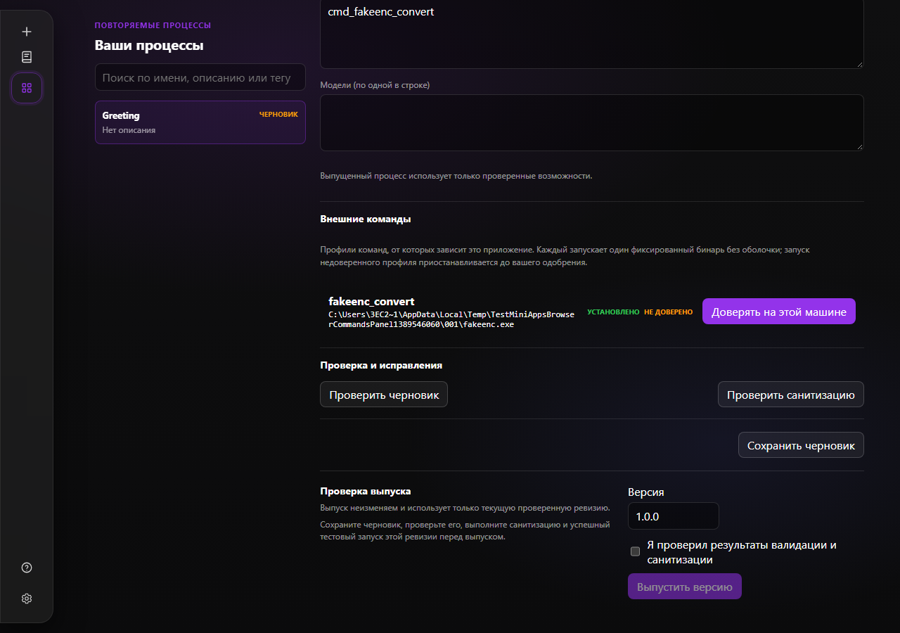
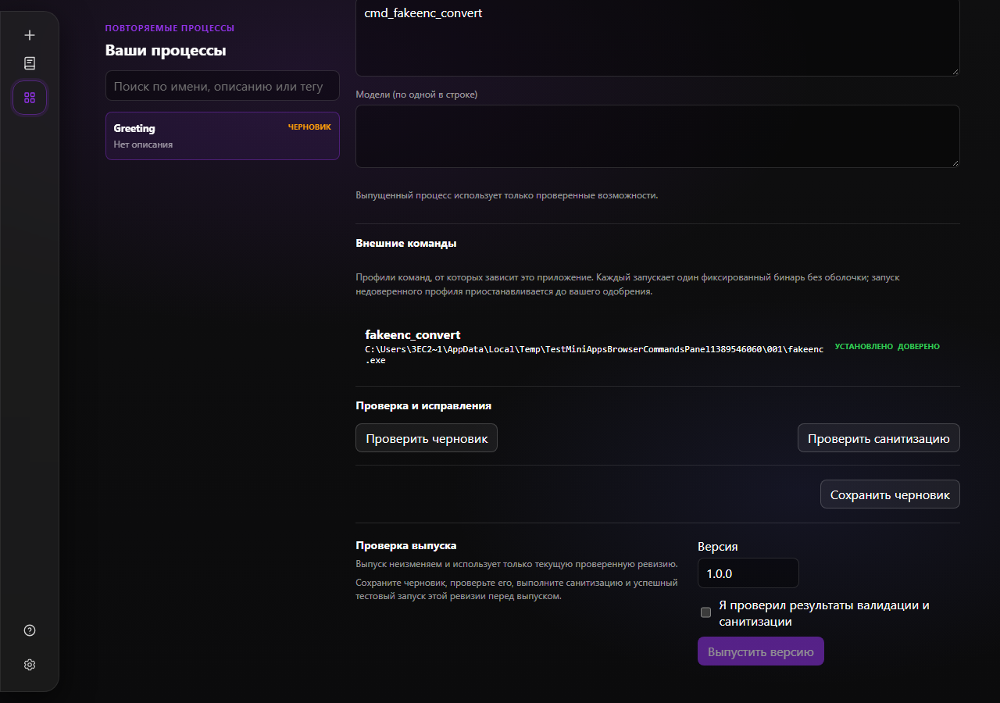
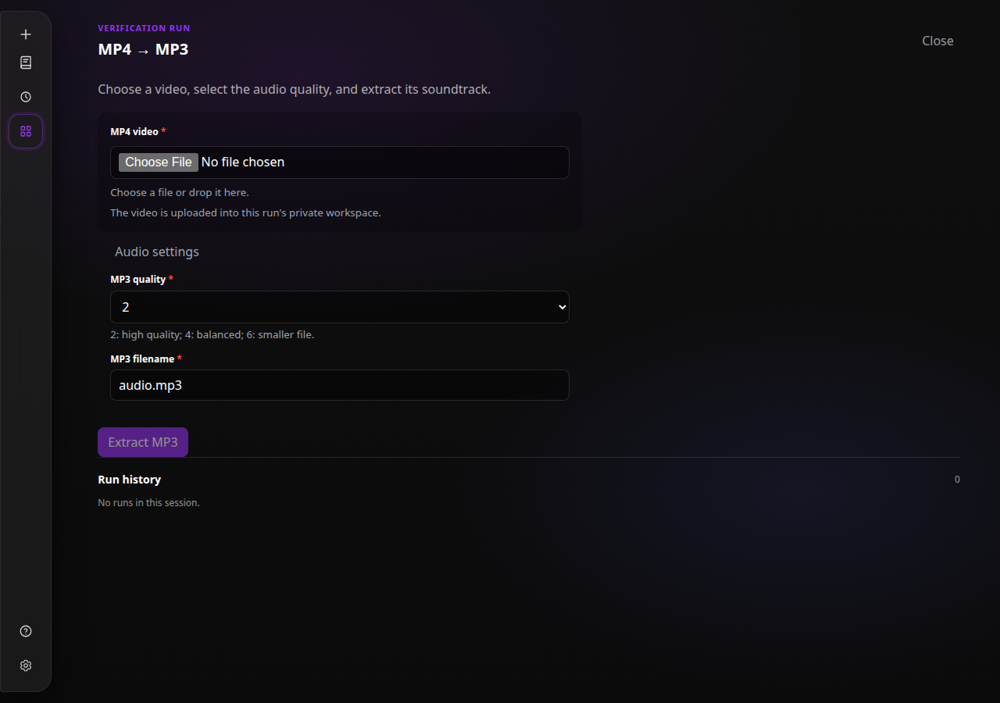
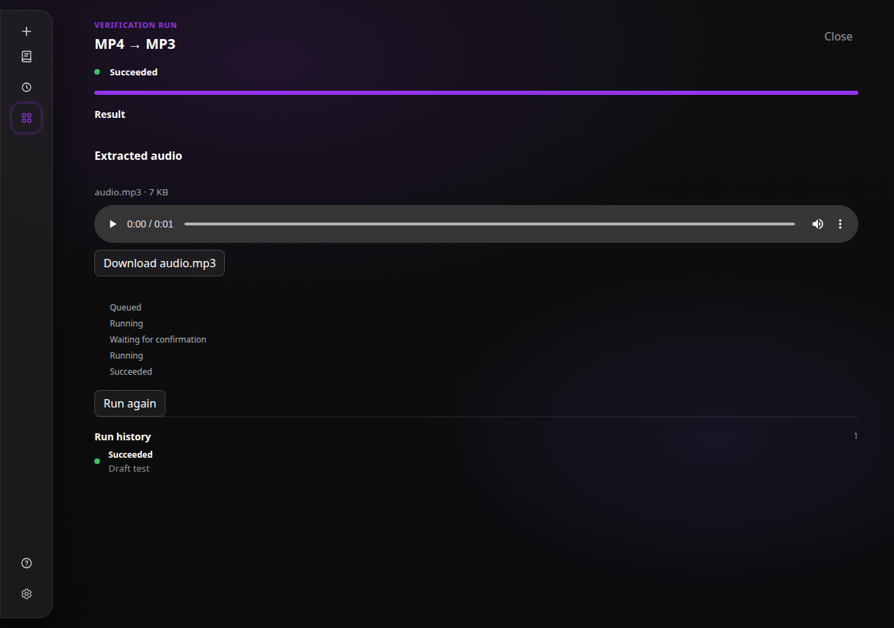

# Mini Apps

Mini Apps turn a completed, successful tool-backed session into a reviewed workflow
that can run again with new inputs. The optional `miniapps` build tag enables the
engine; combine it with `http ui` for the browser workspace. Release builds include
all three. The workspace is available in the browser and desktop app and is hidden
in IDE embeds.

## Create and release a workflow

1. Complete a task with at least one successful tool call, then choose **Create
   Mini App** in the idle chat header.
2. Review the extracted scenarios and choose the task and outcome to preserve.
3. Review the generated draft: metadata, typed inputs, steps, permissions and
   success criteria. Private source evidence stays outside the portable document.
4. Save, validate and sanitize the current draft, then pass a test run against the
   source fixture. The editor assistant can propose repairs; applying one requires
   a fresh round of checks.
5. Review the checks and release an immutable semantic version.

The catalog is at `#/miniapps`; `#/miniapps/{id}` restores a selected workflow.
Press Escape to close the workspace and return to the viewed chat.
Draft saves use revision checks. A changed or stale draft cannot release an older
stored revision. Released runs load the exact version independently of the draft.

## Run and observe

The runner generates controls for text, numbers, booleans, enums, dates and secrets.
It uses persisted asynchronous jobs for progress, confirmation, cancellation and
history. Events reconnect from their last sequence number; polling remains the
authoritative state after a reload. Secret values do not appear in events or
portable exports. Each step reads the current configuration, so changes to a
provider, model or MCP declaration apply without restarting the server.

Only reviewed tools and capabilities are available. Interactive browser tools and
arbitrary shell commands are excluded from unattended runs. Agent steps have their
own tool allowlist and step limit.

## External commands

The [`commands` configuration](../reference/config.md#commands) declares one fixed
binary, an argv template and typed parameters per profile. It registers a
`cmd_<name>` tool. Execution passes arguments directly to the binary without a
shell. `permission: ask` prompts in chat; `allow` runs without prompting and is
required in Mini Apps.

Distillation converts a matching `run_command` into a typed command-profile step.
File parameters become operator inputs. A proposed profile must reproduce the
original argument tokens; pipelines, redirects and shell operators are refused.

An embedded profile requires approval on the machine running the workflow. The
confirmation names its content hash, resolved binary and argument template.
Approval is stored in `<home>/command-trust.json`, bound to the hash and binary
path. Changing either asks again. A matching profile in the operator's own
configuration is already trusted and supplies the local binary path. Trust is
checked before any workflow step runs, so approving a command never repeats an
earlier step's side effects.



*The verification tab shows the resolved binary and asks for machine-local trust.*



*The same profile after approval, ready for verification and release.*

If the binary is missing, the editor's **External commands** panel offers the
detected package managers for the profile's declared coordinates. Installation
requires explicit approval and streams job output. Batch files are refused, the
binary must resolve outside the run workspace, and file arguments stay confined
to it.

## Generated interface and files

The agent describes the interface in the portable document; FoxxyCode renders it
with its own components and theme. `display.title`, `display.description` and
`display.submit_label` control the heading, introduction and launch button.
`display.layout: stacked` uses one column; `form-result` uses the normal form.
Inputs use `ui.order`, optional `ui.group`, descriptions and typed controls:
text, multiline text, numbers, booleans, enums, dates, secrets and file uploads.
The editor assistant can update these declarations without generating executable
HTML or JavaScript. The input editor also exposes File and Files types.

File inputs provide both a chooser and drag-and-drop. Uploads are bound to the
app, input, exact draft revision or release version. The host checks file
extensions, sniffed media types, file counts and byte limits; it copies the bytes
into that run's workspace before tools execute. Entering an arbitrary server
path is unnecessary. Each file is limited to 256 MiB, a multi-file input to 16
files, and staged uploads to 512 MiB per app. Lower limits can be declared with
`validation.extensions`, `media_types`, `max_files` and `max_total_bytes`.
Unselected staged uploads expire after 24 hours and are removed lazily on the
next upload. Explicit removal deletes staging data.

A successful draft test retains the selected uploads as private verification
fixtures. The next test can reuse those exact bytes even after staging cleanup
or a server restart. Saving a draft invalidates its revision-bound checks and
file fixtures; choose source files again for the edited draft. These fixtures
never travel inside a portable release.

Declare a generated file with `outputs[].type: file` and a workspace-relative
`value` (a filename input reference is also supported). A successful run records
a stable file id, name, size, sniffed media type and SHA-256. Renderers `audio`,
`video`, `image` and `download` produce previews or downloads; sniffed content,
rather than the filename, decides which media can be previewed. Ordinary
outputs support text, JSON and tables. Files remain accessible from persisted
run history after a reload. Choosing an old run reopens its results, and an
active run can be cancelled. A command-trust confirmation continues the same
run instead of adding a second history row.

## Example: MP4 to MP3

The [audio-extractor document](../../examples/miniapps/audio-extractor.json)
contains a complete form and a narrow ffmpeg command profile. Create it through
`POST /foxxycode/miniapps`, then open `#/miniapps/audio-extractor`:

```bash
curl -H 'Content-Type: application/json' \
  --data-binary @examples/miniapps/audio-extractor.json \
  http://127.0.0.1:12345/foxxycode/miniapps
```

Add the usual bearer authorization header when the host requires it. In the
browser, choose an MP4, select MP3 quality, set the output filename and choose
**Extract MP3**. Install ffmpeg through the declared package-manager coordinates
if it is missing, and review its machine-local command trust when prompted.
The successful result includes an audio player and **Download audio.mp3**.
A video without an audio track reports a failed conversion instead of a file
that cannot be played. After verification, release an immutable version and run
it with a different upload.



*The generated form accepts an MP4 upload, typed quality options and a result filename.*



*The real ffmpeg result plays in the browser and downloads from the persisted run.*

When distilling a command-backed session, profile parameter types become form
controls. Conventional `output_path`, `output_file`, `destination_path`,
`destination_file`, `target_path` and `target_file` parameters become filename
fields and declared file results; other file parameters become uploads. Review
those inferred roles before testing. Existing source-result comparison still
applies: supplying a file does not silently approve a mismatch against recorded
source evidence.

## Source evidence

Current sessions retain tool arguments and results rather than workspace snapshots.
Successful `write` calls provide their original content for replay and artifact
checks; the current workspace is never read as if it were the historical output.
Older sessions with recorded turn snapshots can still supply those artifacts.
Runs without captured file artifacts are compared through the remaining recorded
tool and result evidence.

See [Web UI](../surfaces/web-ui.md#mini-apps), the
[HTTP API](../reference/http-api.md#mini-apps-rest--tagshttpminiapps), and the
[original design record](../plans/mini-apps-implementation-plan.md).
