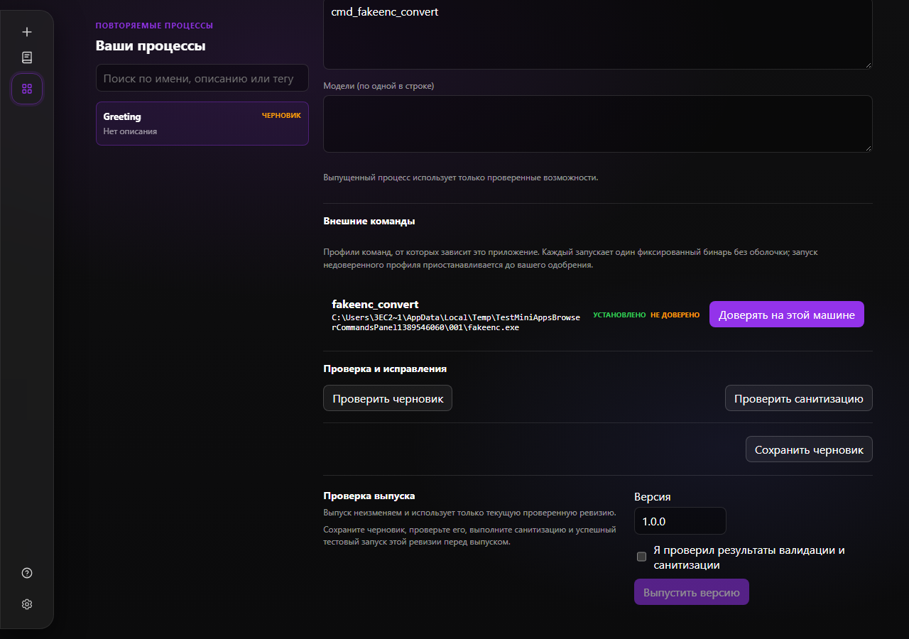
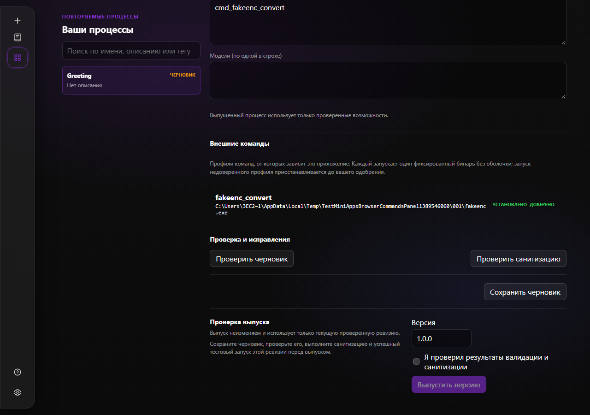

# Mini Apps

Mini Apps turn a completed, successful tool-backed session into a reviewed workflow
that can run again with new inputs. The optional `miniapps` build tag enables the
engine; combine it with `http ui` for the browser workspace. Release builds include
all three. The workspace is available in the browser and desktop app and is hidden
in IDE embeds.

## Create and release a workflow

1. Complete a task with at least one successful tool call, then choose **Create
   Mini App** in the idle chat header.
2. Review the extracted scenarios and choose the task and outcome to preserve.
3. Review the generated draft: metadata, typed inputs, steps, permissions and
   success criteria. Private source evidence stays outside the portable document.
4. Save, validate and sanitize the current draft, then pass a test run against the
   source fixture. The editor assistant can propose repairs; applying one requires
   a fresh round of checks.
5. Review the checks and release an immutable semantic version.

The catalog is at `#/miniapps`; `#/miniapps/{id}` restores a selected workflow.
Draft saves use revision checks. A changed or stale draft cannot release an older
stored revision. Released runs load the exact version independently of the draft.

## Run and observe

The runner generates controls for text, numbers, booleans, enums, dates and secrets.
It uses persisted asynchronous jobs for progress, confirmation, cancellation and
history. Events reconnect from their last sequence number; polling remains the
authoritative state after a reload. Secret values do not appear in events or
portable exports. Each step reads the current configuration, so changes to a
provider, model or MCP declaration apply without restarting the server.

Only reviewed tools and capabilities are available. Interactive browser tools and
arbitrary shell commands are excluded from unattended runs. Agent steps have their
own tool allowlist and step limit.

## External commands

The [`commands` configuration](../reference/config.md#commands) declares one fixed
binary, an argv template and typed parameters per profile. It registers a
`cmd_<name>` tool. Execution passes arguments directly to the binary without a
shell. `permission: ask` prompts in chat; `allow` runs without prompting and is
required in Mini Apps.

Distillation converts a matching `run_command` into a typed command-profile step.
File parameters become operator inputs. A proposed profile must reproduce the
original argument tokens; pipelines, redirects and shell operators are refused.

An embedded profile requires approval on the machine running the workflow. The
confirmation names its content hash, resolved binary and argument template.
Approval is stored in `<home>/command-trust.json`, bound to the hash and binary
path. Changing either asks again. A matching profile in the operator's own
configuration is already trusted and supplies the local binary path.

*The verification tab shows the resolved binary and asks for machine-local trust.*

*The same profile after approval, ready for verification and release.*

If the binary is missing, the editor's **External commands** panel offers the
detected package managers for the profile's declared coordinates. Installation
requires explicit approval and streams job output. Batch files are refused, the
binary must resolve outside the run workspace, and file arguments stay confined
to it.

## Source evidence

Current sessions retain tool arguments and results rather than workspace snapshots.
Successful `write` calls provide their original content for replay and artifact
checks; the current workspace is never read as if it were the historical output.
Older sessions with recorded turn snapshots can still supply those artifacts.
Runs without captured file artifacts are compared through the remaining recorded
tool and result evidence.

See [Web UI](../surfaces/web-ui.md#mini-apps), the
[HTTP API](../reference/http-api.md#mini-apps-rest--tagshttpminiapps), and the
[original design record](../plans/mini-apps-implementation-plan.md).
