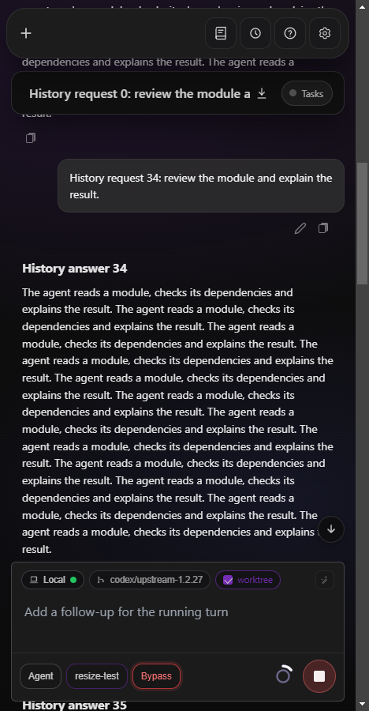
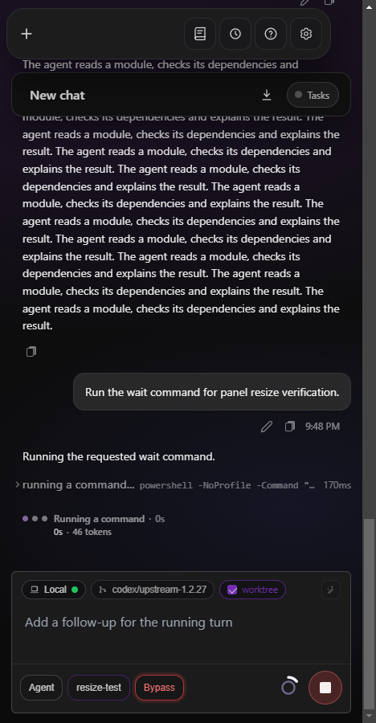
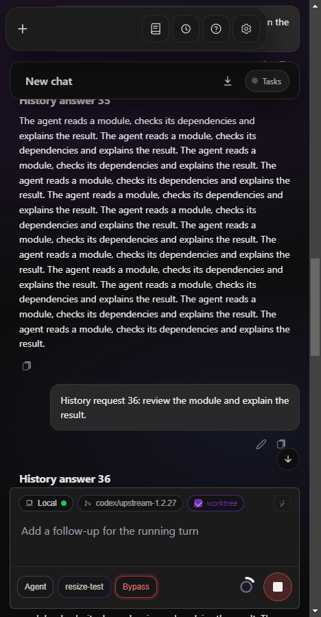

# Transcript position during panel resizing

The desktop shell scrolls `.chat-scroll`; below 1200 CSS pixels the document
scrolls instead. The old scroll offset was not transferred, and a transient
offset could also turn off follow-to-bottom. The fix remembers the preceding
layout, restores the bottom for a following reader, and otherwise restores the
first visible row's offset after reflow and the deferred composer reserve.

## Real IntelliJ verification

IntelliJ IDEA Community 2022.2.1, JCEF/Chromium 104, Windows x64. The test used
an isolated local OpenAI-compatible provider and a real foreground PowerShell
command (`Start-Sleep -Seconds 90`), stopped after verification. No external
provider or real API key was used. The sandbox was closed and its previous
configuration restored.

The previous build, `0.0.0-dev-pr143-f9dd7273b`, reproduced the report:
resizing from 1280 to 468 px left the viewport **3050 px above the end**.

With the fix, the running command stayed at the bottom (**0 px distance**) at
468, 390, 599, 600, 834, 1199, 1200 and 1280 px. The same eight transitions
while reading history preserved the visible row with **0.75–2 px drift**.

Full measurements: [JCEF results](jcef-results.json),
[baseline measurements](baseline-results.json).

## Other verification

- Regression scenarios in `features/ide_panel_resize_loop.feature` failed before
  the fix for both the newest message and history reading, then passed with it.
- A real 3306-message, 9.3 MB transcript passed scrolling and the 16 resize
  checks in Chromium and WebKit, including bounded DOM and disabled native
  scroll anchoring. WebKit has no native anchoring; drift stayed within 4 px.
- Full `make test`: 312 SPA test files, 2937 tests and all full-tag Go packages.
- `make lint`, `make docs`, `make docs-check`, embedded SPA build.
- `npm ci` followed by `npm run test:layout`.

The change preserves reading position; it does not change layout or colors.
