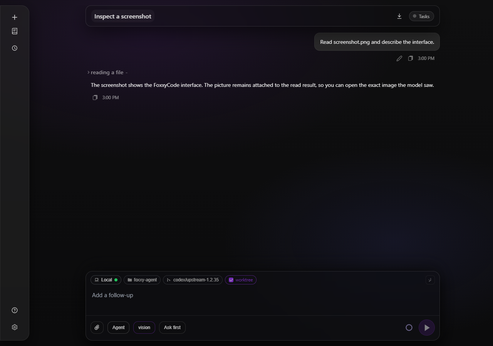
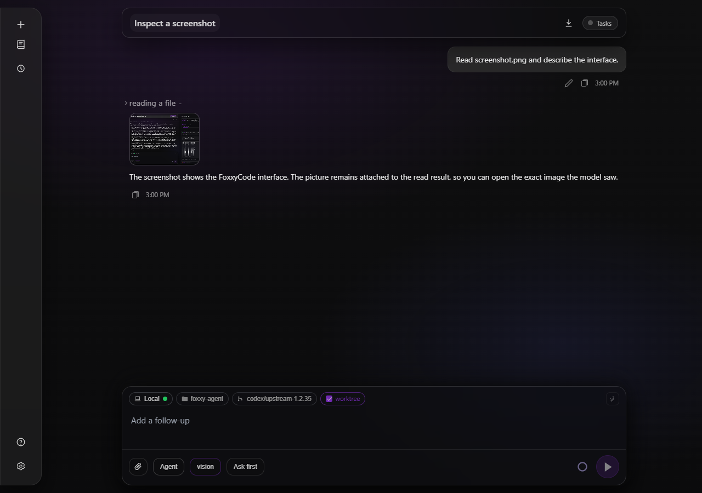
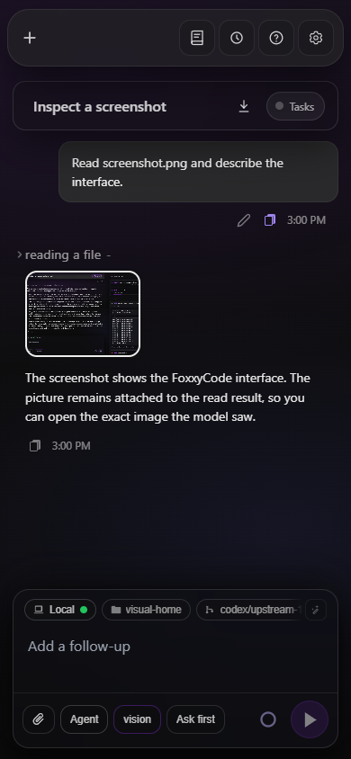
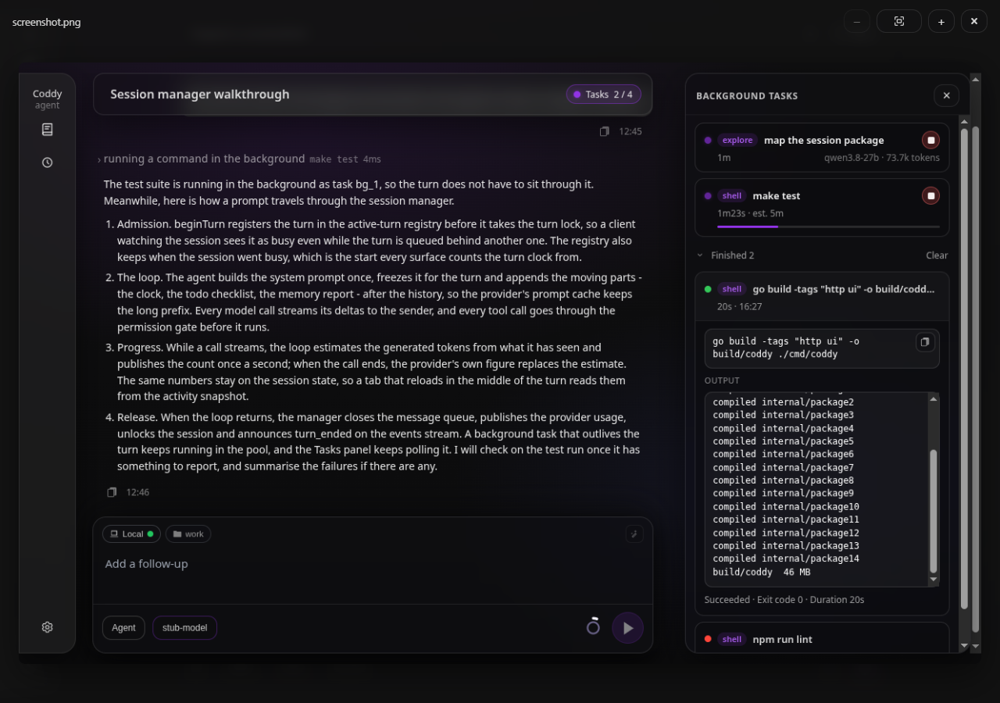
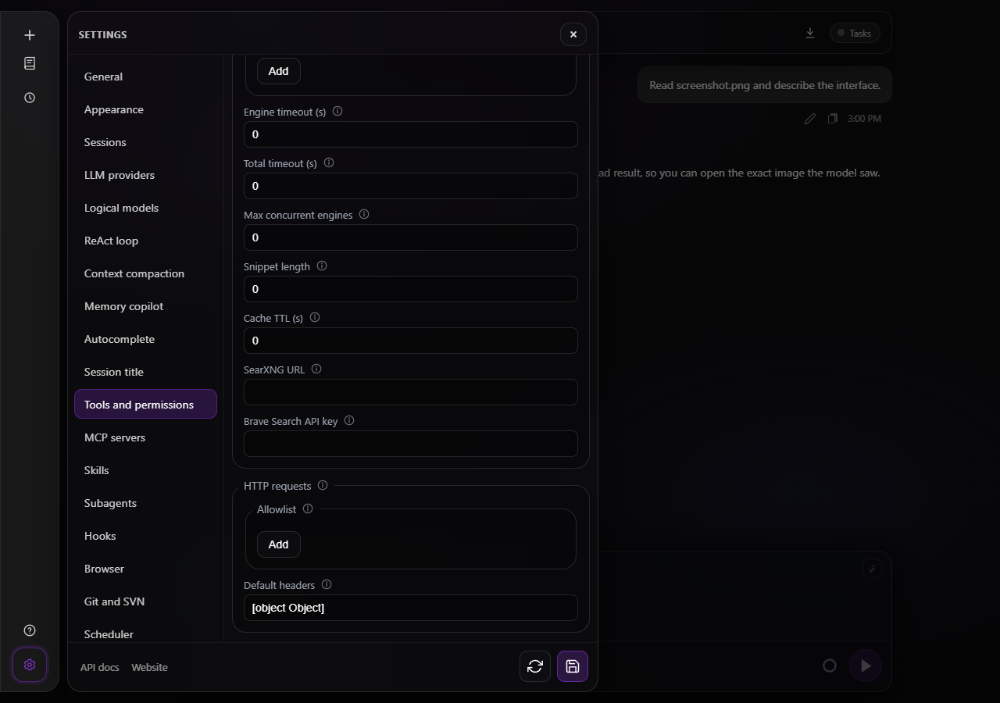
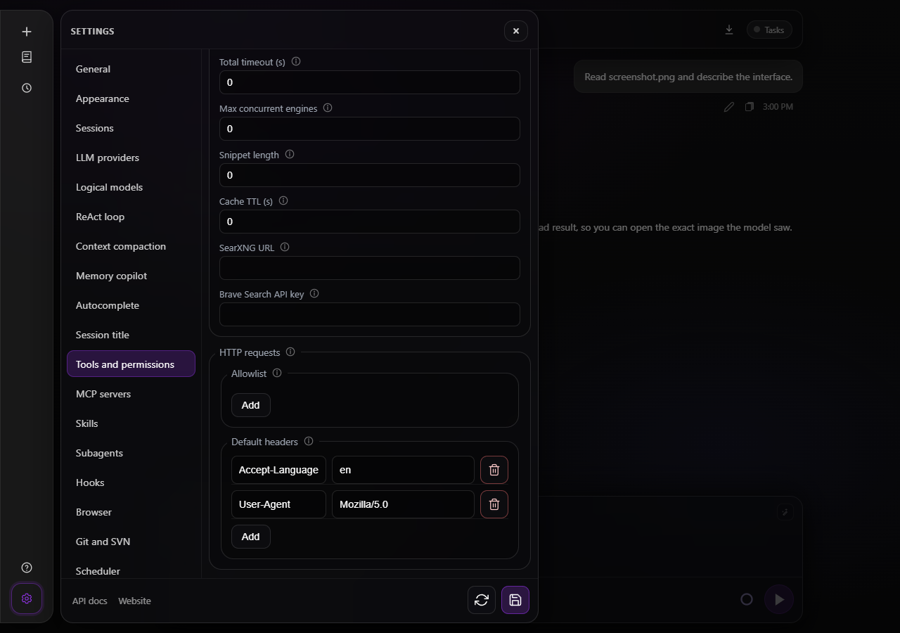
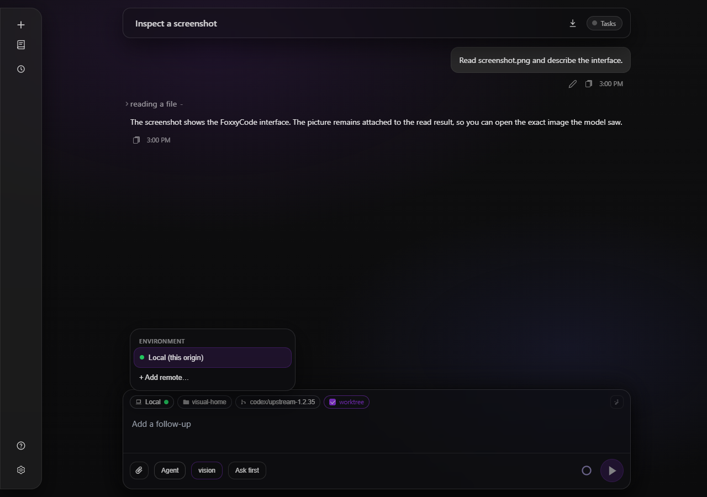
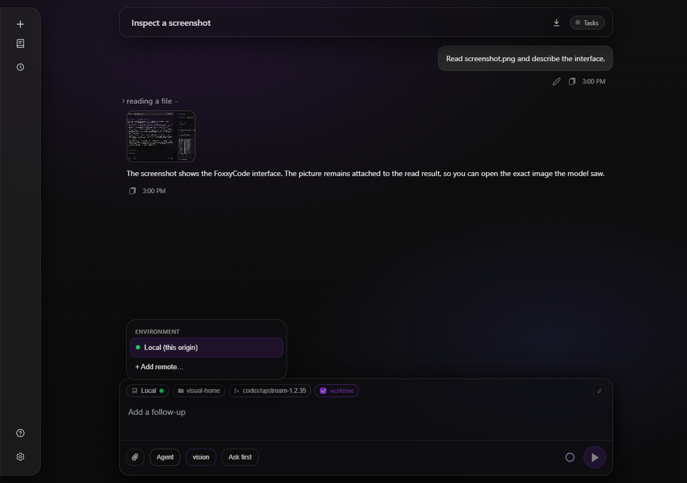

# FoxxyCode port through coddy-agent 1.2.35

Branch: `codex/upstream-1.2.35`.

- Implementation: `2710b9ea32549cb1ccd8279079434955916548a0`.
- Coverage/checkpoint: `d6c9d2b53`.
- 66 upstream commits accounted for: 60 adapted, six overlapping integration merges skipped; no pending commits in the range.
- Full Go tag suite passed; 2,976 SPA tests passed.
- Lint, Windows lint/build/vet, prompt-cache tests and docs checks passed.
- Chromium 104, browser layout/menu checks, 360–1280px overflow checks and WebKit scroll checks passed.
- MCP stdio/npx/HTTP/SSE end-to-end test passed.
- Android cross-build and race detection could not run without the NDK/C toolchain.

## Captures

The before screenshots use UI sources from the original revision; the after screenshots use the running port. The isolated local backend uses a seeded transcript and local image assets.

