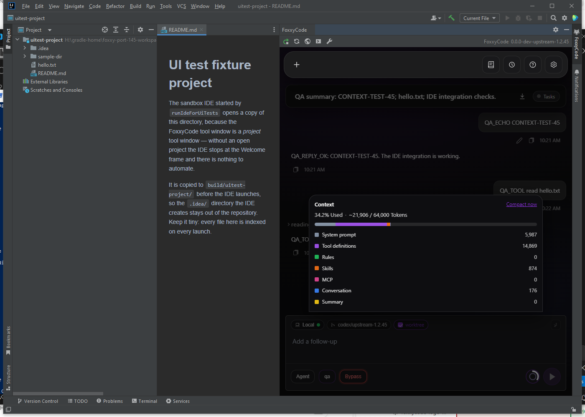
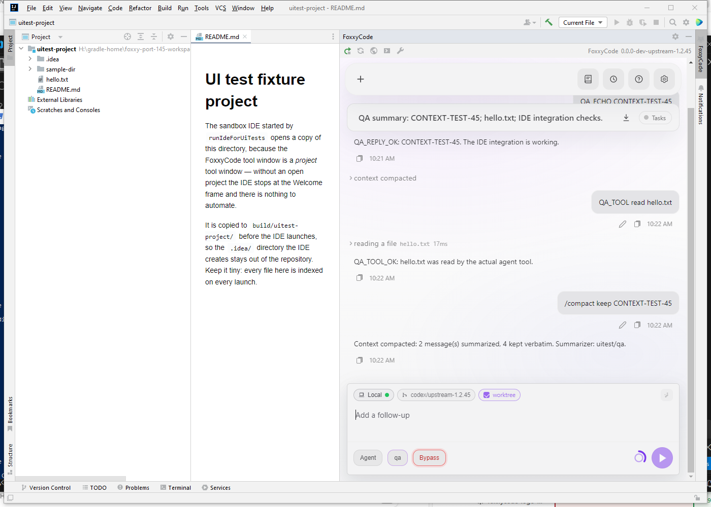
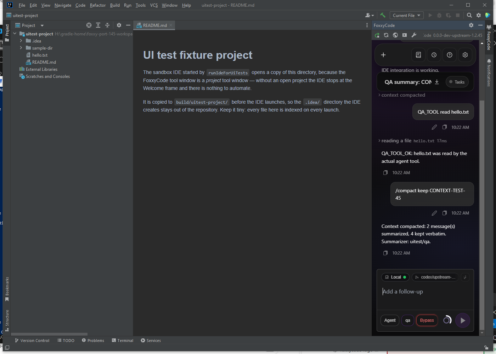
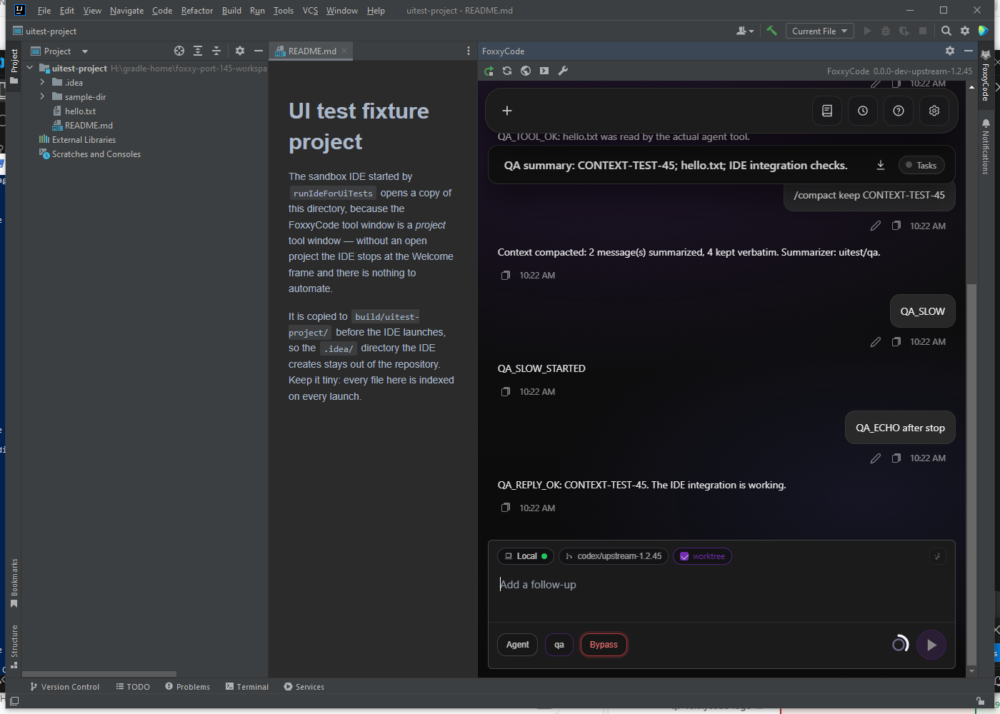
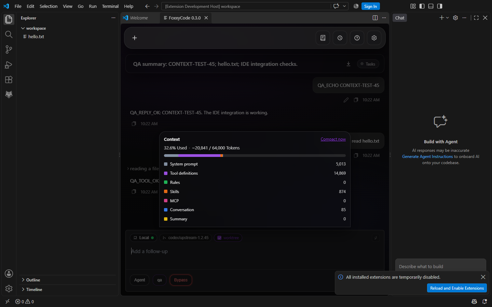
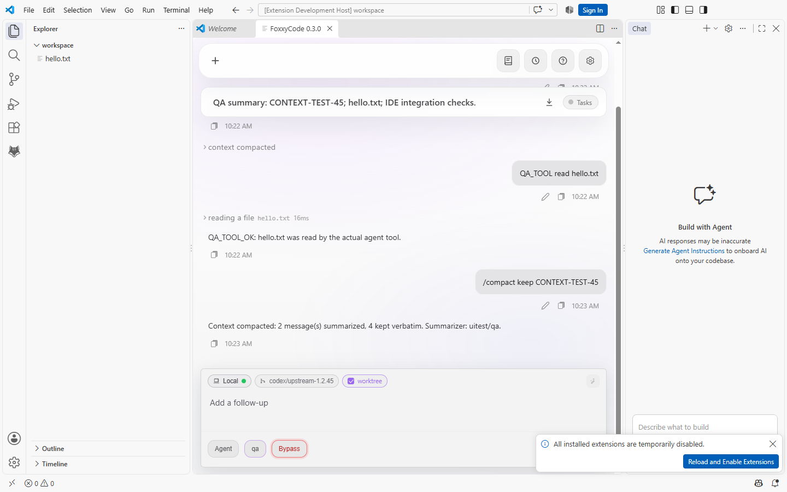
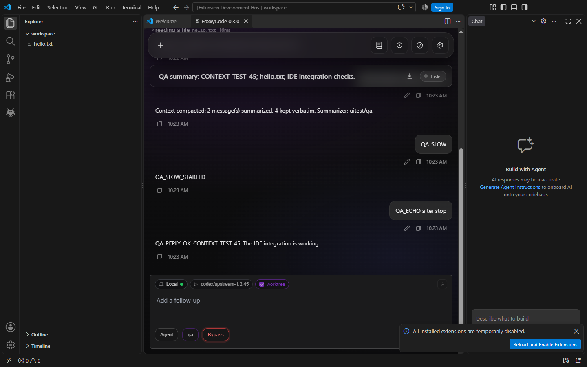

# IDE acceptance run: upstream 1.2.45

Date: 2026-10-29. Revision: `a7298e785e993bc7bc62cf918b294bacd622d7f2` (PR #151).

| Surface | Environment | Result |
|---|---|---|
| IntelliJ unit tests | JDK 17, Gradle 8.10.2, Windows x64 | 112 passed |
| IntelliJ UI regression | Real IntelliJ IDEA Community 2022.2.1, build IC-222.3739.54, JBR 17.0.3+7-b469.37, JCEF | 7 passed, zero failures/errors |
| IntelliJ live acceptance | Remote Robot plus trusted CDP input into JCEF | Passed |
| VS Code unit tests | TypeScript check, Vitest, extension compilation | 20 files / 166 tests passed; typecheck and compilation passed |
| VS Code host/webview acceptance | Real VS Code 1.140.0 Extension Development Host, Windows x64 | 14 checks passed |
| IntelliJ development ZIP | Fresh server extracted from the ZIP | Version, startup, embedded UI and crossreview catalog passed |

The unit suites were run before the final review commit, which changes documentation and one Go guard test, not plugin implementation or SPA source. The actual IDE acceptance runs and ZIP/server smoke test were repeated after updating to that commit.

## IntelliJ coverage

The permanent suite checks all toolbar actions, backend startup and browser dimensions, the SPA/composer mounting inside JCEF, theme changes without an internal IDE error, opening a long persisted transcript without a ResizeObserver loop, a long MCP label at narrow width, and closing/reopening the tool window.

The additional script checks the local server version footer, trusted keyboard input, streamed replies, a real `read` tool call against the sandbox project's `hello.txt`, context breakdown and its manual action, `/compact` with `auto_enable: false`, light/dark theme propagation, absence of document horizontal overflow at a 320 px panel, Stop, and a successful following turn. The sandbox exits normally through its automation exit command.

## VS Code coverage

The actual extension host checks activation, registered commands and server startup. The webview driver checks its footer version, Add to Chat inserting a project-relative file mention, trusted Enter submission and streamed response, a real `read` tool call, context breakdown, manual compaction with automation disabled, IDE light-theme propagation, no horizontal document overflow, Reload retaining the transcript, backend Restart restoring the conversation, and Stop followed by a successful new turn.

This is a development extension loaded from the current source, using the current Go server extracted from the IntelliJ test ZIP through the supported binary-path setting. The extension tab's `0.3.0` label is the source package version; the server footer identifies `0.0.0-dev-upstream-1.2.45`. CI separately built the universal VSIX successfully.

## Scope and environment notes

The IDEs, plugin code, embedded SPA, Go server, SSE path, file tool and compaction plumbing are real. A local scripted OpenAI-compatible provider supplies deterministic responses and summary text; no personal provider credentials or histories are used. This verifies integration and behavior, not a model's reasoning or summary quality.

This IDE run does not cover external crossreview CLI accounts, a live multi-machine swarm, authenticated production remotes, all MCP lifecycle/trust combinations, worktree creation, OS drag-and-drop, or 125%/150% DPI. The port's Go/BDD suite and CI cover additional core cases; those are not represented as manual IDE acceptance here.

Environment issues were confined to the test harness: Gradle worker argfiles cannot resolve Cyrillic paths, so tests use an ASCII junction and ASCII Gradle home. Vite is built through the real path before the alias-based sandbox task. The scripted provider ignores ambient `turn_context`, the UI driver waits for turn completion, and CDP attaches after the VS Code webview exists. No production implementation fix was required by these IDE runs.

CI for IntelliJ plugin ZIP, VS Code extension tests/universal VSIX and the full Go race detector is successful. The AppSec scanner job also succeeded under the agreed gate, but GitHub's separate Trivy SARIF check remains red for three high and 13 medium dependency alerts. That check is not a plugin test failure.
